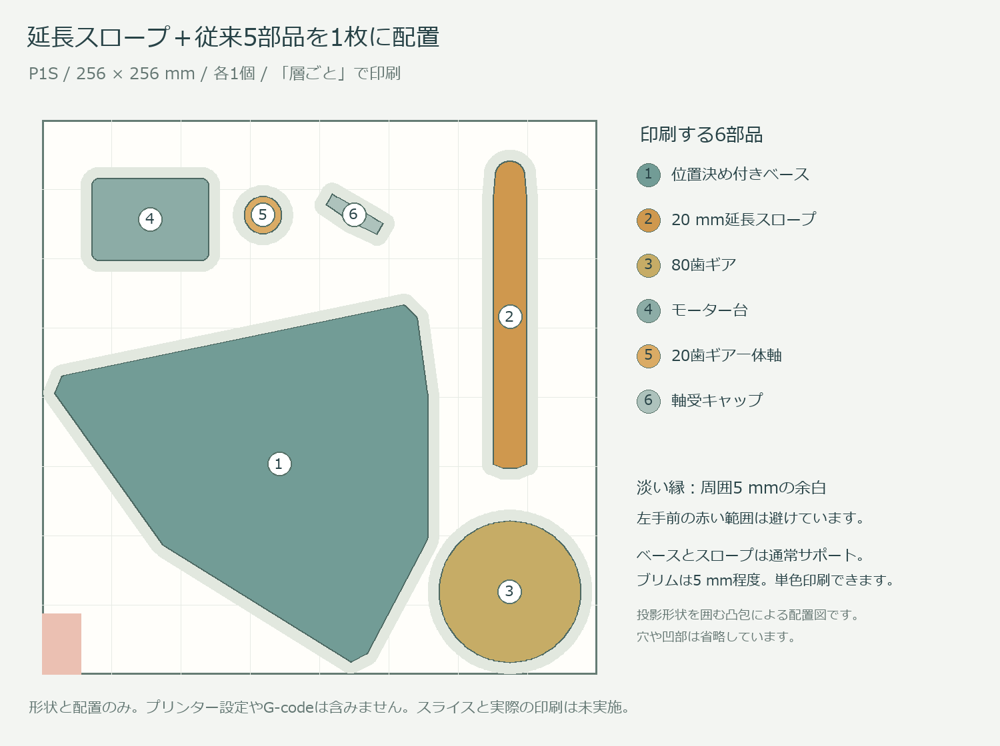

# 延長スロープと従来の駆動部品 / P1S 1枚配置

作成日: 2026-11-09

**20 mm延長スロープと従来の5部品、計6点を各1個、P1Sの1枚のプレートに配置しました。** `print/01_motion_complete_plus20_P1S.3mf` を使います。

ここでの「一式」は、v5の最初の駆動試験プレートに相当する下部機構です。バスケット、中央ケース、蓋、上部の識別機構、フィーダーはこのプレートに含みません。既存の上部機構、中間プレート、モーター、電源、制御機器、ボルトとナットは別途使います。

## 印刷する部品

| 部品 | 個数 | 今回の扱い |
|---|---:|---|
| 位置決め付きベース | 1 | v5のSTLをそのまま収録 |
| 20 mm延長スロープ | 1 | 作成済み延長版のSTLをそのまま収録 |
| 80歯ギア | 1 | v5のSTLをそのまま収録 |
| 20歯ギア一体軸 | 1 | v5のSTLをそのまま収録 |
| モーター台 | 1 | v5のSTLをそのまま収録 |
| 軸受キャップ | 1 | v5のSTLをそのまま収録 |

形状、縮尺、上下の印刷向きは変えていません。プレート上の位置と水平面内の向きを調整しています。元の短いスロープは含めていないため、新旧を重複して印刷することはありません。単品データは `stl/` に収録しています。

v5の容器と全ての蓋も新規製作する場合は、この1枚をv5の01と置き換え、従来の02〜07を使います。その場合は合計7回のままです。任意の試験片はその回数に含みません。すでに従来5部品を持っていれば、作成済みのスロープ単品プレートだけでも交換できます。

## Bambu Studioでの設定

1. `print/01_motion_complete_plus20_P1S.3mf` を開き、P1Sと使用中のノズル、材料を選びます。6個のオブジェクトがあることを確認してください。
2. 単位はmm、縮尺100%です。保存済みの位置と印刷向きを保ち、自動配置や自動回転は使わないでください。
3. 印刷順序を **「層ごと / By layer」** にします。高さ90 mmのベースを含むので、オブジェクトごとに完成させる順次印刷では使いません。
4. ベースとスロープに **通常サポート / Normal、ビルドプレート上のみ、水平拡張0 mm** を開始設定にします。ブリムは5 mm以下を目安にします。実際に生成されたサポートとブリムが外周5 mmの確保範囲を越えず、造形範囲内に収まり、隣の部品へ接触しないことをプレビューで確認してください。
5. スロープは長い外底が約6.9 mm浮くので、外側の底と根元を支持します。流路と差込軸穴の内部にはサポートを入れないよう調整します。ベースの穴にもサポートを詰めないよう、必要に応じてペイントで除外します。
6. スライスのプレビューで、スロープの外底の支持、軸穴天井の約3.2〜5.2 mmの橋渡し、小ギアの歯先が残ることを確認してから印刷します。

3MFは形状と配置のみです。プリンター、材料、積層、サポート等の設定やG-codeは含みません。単色で印刷でき、AMSは不要です。スライスと実際の印刷は未実施なので、印刷時間と材料量はBambu Studioで確認してください。

0.4 mmノズルなら、全体は積層0.16 mm、Arachneを出発点にできます。材料の温度と速度は実際のフィラメントに合わせます。

| 部品 | 外周数の開始設定 | 充填率の開始設定 |
|---|---:|---:|
| ベース | 4〜5周 | 30〜40% |
| スロープ | 4周 | 100% |
| 80歯ギア | 5周 | 40%以上 |
| 20歯ギア一体軸 | 5周 | 100% |
| モーター台 | 4周 | 40% |
| 軸受キャップ | 4〜5周 | 100% |

スロープの薄い部分では、設定した4周がそのまま収まるとは限りません。小ギアは歯先幅が約0.45 mmなので、プレビューで欠けていないことを確認します。

## 組立時の扱い

組立はv5と同じです。モーター台をベースに固定し、28BYJ-48を載せ、20歯ギア一体軸を軸受キャップで保持します。80歯ギアをモーター軸へ固定し、延長スロープを出力軸へ差し込みます。フィーダー用DCモーターの取付部品ではありません。

固定部品は従来どおりM3×8が5本、M3×12が8本、M3ナットが13個です。このうちモーター台の底側4本には、頭の高さ2.2 mm以下のM3×8ボタンボルトを使います。モーターや既存上部の実際の構成に合わせて使ってください。追加のスロープ固定ねじはありません。

延長スロープは水平距離106→126 mm、主流路幅12 mm、半円断面を維持した形状です。入口側20 mmと差込軸穴はv5と同じで、末端の傾斜は約18.04°です。

作成済み延長版の形状確認では、トレー上端への隙間は傾きを考慮して最低約3.27 mmです。一方、横方向へ傾いた端位置では、元のv5と同じ入口外縁の微小接触が残っています。入口の形状を変更していないため、組立後は入口側も含めて手でゆっくり旋回させ、実物で接触がないことを確認してください。詳細は同梱の `CHUTE-NOTES.md` を参照してください。

## 確認した範囲

- 6個のSTLは、元のv5または作成済みの延長版とファイルのハッシュが一致します。
- 全ての部品は閉じた立体で、底面がZ=0、高さは最大90 mmです。
- P1Sの256 × 256 × 256 mm内に、各部品の投影形状を囲む凸包とその外側5 mmが収まります。
- 左手前の18 × 28 mmの除外範囲を避けています。
- 凸包間の最小距離は約11.83 mmで、各部品の5 mmの余白同士も重なりません。
- 検査対象は形状と余白です。スライサーが生成するサポートそのものや、実物の印刷成功を確認したという意味ではありません。

配置と確認結果は `source/layout.json` と `verification/` に収録しました。
