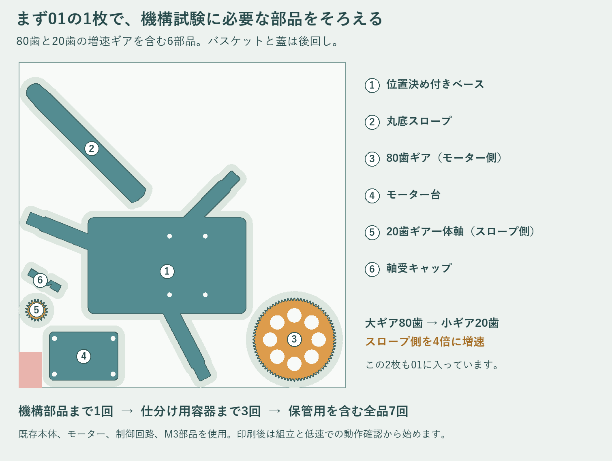
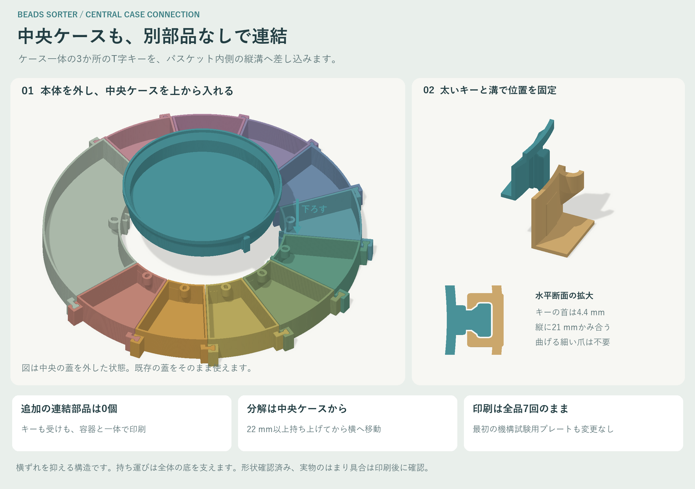
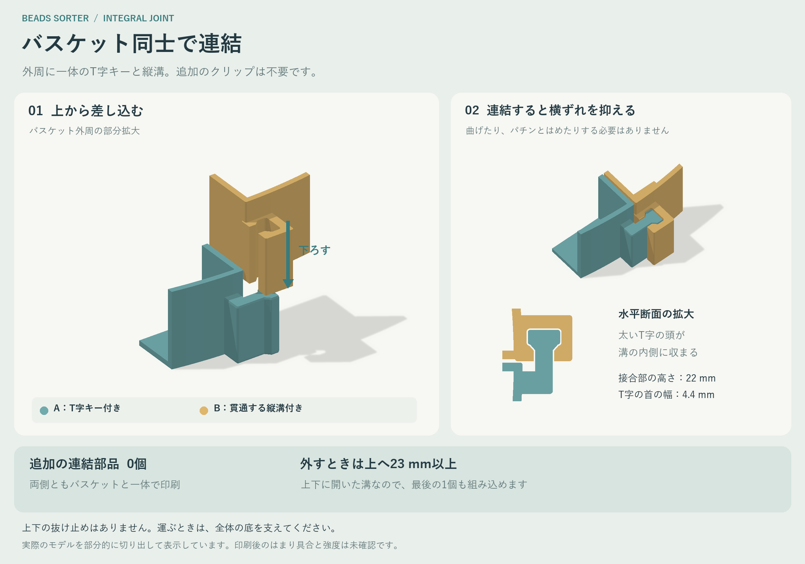
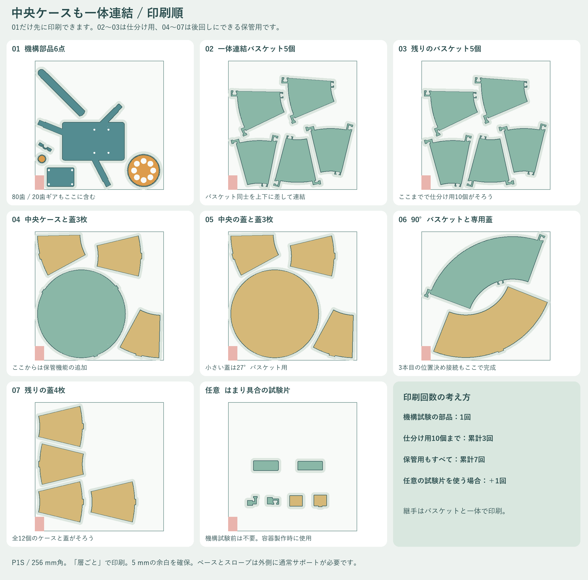
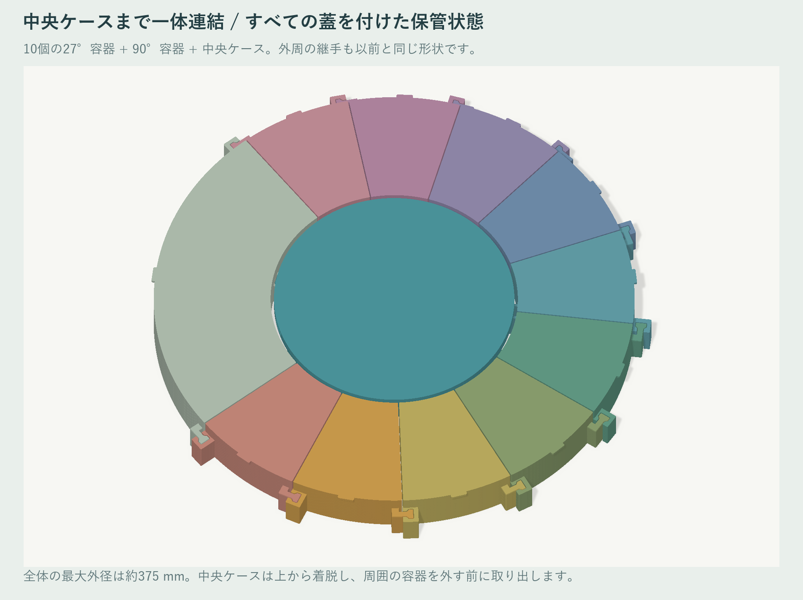

# ビーズ仕分け機 / P1S用 v5 中央ケースも一体連結

**中央ケースにも3か所のT字キーを一体化し、周囲のバスケットへ上から差し込んで連結できるようにしました。** バスケットの内側に受けを追加しています。外周のバスケット同士の一体式継手も引き継いでおり、容器の連結に使う別部品は0個です。

**最初の1回で、増速機構と新しいスロープの試験に必要な6部品がそろう印刷順は維持しています。** 80歯と20歯の増速ギアを含む01のプレートはv4と同じデータです。バスケット、中央ケース、蓋を待たずに、下部機構を組み立てて試せます。

既存の上部機構、中間プレート、28BYJ-48モーター、ドライバー、電源、制御用機器、M3ボルトとナットが用意されていることを前提とします。このデータは、それらを含めた仕分け機全体の新規製作一式ではありません。

| ここまで印刷 | そろうもの | できる確認 |
|---|---|---|
| **01の1回** | 交換ベース、丸底スロープ、80歯ギア、20歯ギア一体軸、モーター台、軸受キャップ | 歯車のかみ合い、首振り、手で入れたビーズの通過 |
| **01〜03の計3回** | 上記に一体式の継手を備えた27°バスケット10個を追加 | 270°の10区画への排出。90°容器側の位置決めはまだ未装着 |
| **01〜07の計7回** | 90°バスケット、中央ケース、全12個の蓋まで追加 | 360°の収納配置と本体への3点の位置決め |

本番の印刷はv4と同じ**計7回**です。中央ケース用の受けを追加した27°バスケットを、02と03へ5個ずつ配置し直しました。02と03の配置は同じです。容器と蓋を後回しにするため、最初の稼働試験までに必要なのは01の1回だけです。印刷時間の見積もりはスライス後に確認してください。Bambu Studioでのスライスや実際の印刷は未実施です。

`OPTIONAL_fit_checks.3mf` は一体式の継手、容器の蓋、本体の位置決めを確認する試験片6点です。01の前に印刷する必要はありません。容器を作る段階で任意に追加すると、全体では8回になります。これらは外周継手、蓋、本体の位置決め用で、今回の中央接続を再現した専用試験片ではありません。

## 中央ケースの連結

1. 本体を外し、27°バスケット10個と90°バスケットを机上で連結して360°の輪にします。
2. 中央ケースの3つのT字キーを、90°バスケット、27°バスケットの04番と08番の内側にある溝へ合わせます。3か所が同時に合う向きまで中央ケースを回します。
3. 中央ケースを傾けず、底が机に着くまで垂直に下ろします。蓋は閉めたままでも着脱できます。横から押し込む構造ではありません。
4. 分解するときは、**最初に中央ケースを22 mm以上持ち上げて**取り出します。その後、周囲のバスケットを23 mm以上持ち上げて外します。

**中央ケースを入れたまま周囲のバスケットを持ち上げないでください。** 中央ケースの広がった上部が受けの上にあるため、引っ掛かります。中央ケースから順に外す構造です。

中央のキーは首幅4.4 mm、頭幅7.6 mm、頭の奥行き3.1 mm、かみ合い高さ21 mmです。受けの左右の壁は公称2.05 mm、はめ合いの隙間は片側0.35 mmです。薄いばね爪を曲げる方式ではありません。キーと受けは容器と同時に印刷するため、紛失する連結部品はありません。

27°バスケット10個は同じ形状で、それぞれに中央ケース用の受けがあります。中央ケースが実際につながるのは3か所で、残りの8か所は空いた状態です。受けは本体の底板と位置決めアームを避けた配置です。

中央ケースは上端の外径175 mmと蓋の取付形状を維持し、下部の外径を163 mmにしています。高さ19〜25 mmで45°に広げ、斜面でも壁厚2.2 mmを確保しました。これにより、以前の中央蓋を使いながら、下側に連結形状のスペースを作っています。公称の満水容量は約640 mLから約575 mLになります。蓋を閉めて使う際は、縁から5 mm程度空けてください。

この連結は横ずれと回転を抑えるためのものです。持ち上げ方向にはロックしません。中央ケースを取っ手として全体を持ち上げず、運ぶときは全体の底を支えてください。

## 以前の印刷品を使う場合

| 部品 | v4との関係 |
|---|---|
| ベース、スロープ、80歯と20歯のギア、モーター台、軸受キャップ | 同じデータ。再印刷不要 |
| 27°用、90°用、中央用のすべての蓋 | 同じデータ。再印刷不要 |
| 外周のバスケット同士の継手 | 同じ形状。v4とv5を外周で連結可能 |
| 中央ケース | 3つのキーと細くした下部を持つv5へ変更 |
| 中央ケースと直接つなぐ容器 | 90°容器1個と27°容器の04番、08番をv5へ変更 |

すでにv4のバスケットを印刷している場合は、**残り8個の27°バスケットを再使用できます。** v5の中央ケース1個と、それが直接つながる3個のバスケットを作れば、中央連結を追加できます。この混在状態での差し込みも形状確認済みです。未製作の場合は同梱のv5プレートを使えば、全バスケットを同じ仕様にできます。

以前の中央ケースは新しい内側の受けに当たるため、v5バスケットの輪には入りません。v3以前の別クリップ式バスケットは、外周の継手が異なります。

## 外周の一体式の連結について

隣のバスケットと継手の位置を合わせ、上から垂直に下ろして連結します。横へ押し込んだり、爪を曲げてはめたりする方式ではありません。継手のかみ合い高さは22 mmです。外すときは、対象のバスケットを隣より**23 mm以上持ち上げて**抜きます。本体の位置決めピンが入っている場合は、先に本体を持ち上げて取り外してください。中央ケースが入っている場合も、先に中央ケースを取り出します。

凹側の溝は上下に貫通しています。このため、先に並べた10個の間へ最後の90°バスケットを下ろして、360°の円を閉じることができます。片側の凸が隣の溝へ上から入り、もう片側では隣の凸が新しい容器の溝へ下から入ります。

凸部は首幅4.4 mm、頭幅8.0 mm、頭の奥行き3.6 mmです。凸の上下端には高さ0.65 mmの範囲に0.25 mmの案内面を設けています。凹溝はまっすぐ貫通する形で、別の入口面取りは付けていません。はめ合いは片側0.35 mmの隙間を出発点にしています。

薄いばね爪を繰り返し曲げず、太い継手で机上の横ずれを抑える設計です。上下方向にはロックしないので、個別の取り外しができます。連結した全体を運ぶときは、すべての容器の底を支えてください。実物の強度、はまり具合、繰り返し使用による摩耗は未確認です。

今回の変更は27°バスケット、90°バスケット、中央ケースの3種類です。外周の継手と、すべての蓋の形状は維持しています。

## 増速ギアについて

**`01_motion_test_complete.3mf` に、80歯ギア1個と20歯ギア一体軸1個を収録しています。** モーター側の80歯から出力側の20歯へ伝える4倍増速です。前のv2では最後の06Bへ分けていましたが、この版では最初から必要部品として01へまとめています。

個別STLの `03_drive_gear_80t.stl` と `04_output_gear_20t_spindle.stl` は、以前の形状を引き継ぐため、従来と同じ `optional_reprint_stl/` フォルダ内にあります。フォルダ名は過去の分類であり、**歯車がなくても動かせるという意味ではありません。** 未製作であれば、01に含まれる歯車、モーター台、軸受キャップをすべて印刷します。すでに持っている同じ部品は再使用できます。

80歯ギアの外径は65.6 mm、20歯ギアの外径は17.6 mm、歯幅は5 mmです。モジュール0.8、圧力角20°のインボリュート歯形を前の設計から変更せず使用しています。

## 印刷プレート

印刷には `plates/` の3MFを使用します。各ファイルが1枚のプレートです。01〜07を各1回印刷すると、本番部品がすべてそろいます。同じ番号の代替プレートを選ぶ必要はありません。

| ファイル | 内容 | 印刷時期 |
|---|---|---|
| `01_motion_test_complete.3mf` | ベース、スロープ、80歯ギア、20歯ギア一体軸、モーター台、軸受キャップ | 最初。1回で駆動部品がそろう |
| `02_five_bins.3mf` | 一体式の27°バスケット5個 | バスケットで受ける試験へ進むとき |
| `03_five_bins.3mf` | 残りの一体式27°バスケット5個 | 10区画をそろえるとき |
| `04_central_case_and_three_lids.3mf` | 中央ケース、27°バスケット用の蓋3個 | 保管用。後回しでよい |
| `05_central_lid_and_three_lids.3mf` | 中央ケースの蓋、27°バスケット用の蓋3個 | 保管用。後回しでよい |
| `06_bin90_and_lid90.3mf` | 90°バスケットと専用の蓋 | 360°の接続と3点の位置決めを完成させるとき |
| `07_four_lids.3mf` | 残りの27°バスケット用の蓋4個 | 保管用。後回しでよい |
| `OPTIONAL_fit_checks.3mf` | 継手の凸と凹、蓋と小ケース、位置決めのピンと穴の計6点 | 任意。容器を作る前の確認用 |

01〜03の後は、04〜07を必要な順に印刷できます。本体と容器の3点の位置決めを早く完成させたい場合は、06を04と05より先に印刷してください。

P1Sの256 × 256 × 256 mmに合わせ、5 mmのブリム用余白と部品間の間隔を確認しています。左手前の除外領域も避けています。部品を容器の床へ重ねる配置ではなく、すべての部品が直接ビルドプレートから造形を開始します。

すべてmm、100%の大きさで読み込み、保存された位置と印刷方向を保ちます。自動配置や自動回転は使わず、印刷順序を**「層ごと / By layer」**にします。高さの違う部品を同時に印刷するため、「オブジェクトごと」の順次印刷は使いません。

3MFは形状と配置のデータです。プリンター、材料、積層ピッチ、サポート等の設定やG-codeは含みません。画像の色は部品を識別するための表示で、AMSや多色印刷は必須ではありません。

## 印刷設定の目安

標準の0.4 mmノズルとPLAを出発点にします。**01は積層ピッチ0.16 mm**を基本とし、歯車の形状をさらに細かく確認する場合は0.12 mmも候補にできます。壁生成はArachneを推奨します。外周数や充填率は、同じプレート内でもオブジェクト単位で設定できます。

| 部品 | 積層ピッチ | 外周 | 充填率の出発点 | サポート |
|---|---|---:|---:|---|
| 位置決めアーム付きベース | 0.16 mm | 4〜5周 | 30〜40% | 上部取付部、横腕、ピンの下面 |
| 丸底スロープ | 0.16 mm | 4周 | 100% | 外側の底面と軸穴ボスの下 |
| 80歯ギア | 0.12〜0.16 mm | 5周以上 | 40%以上 | スライスのプレビューで確認 |
| 20歯ギア一体軸 | 0.12〜0.16 mm | 5周 | 100% | スライスのプレビューで確認 |
| 軸受キャップ | 0.16 mm | 4〜5周 | 100% | スライスのプレビューで確認 |
| モーター台 | 0.16 mm | 4周 | 40% | スライスのプレビューで確認 |
| バスケット、中央ケース | 0.16〜0.20 mm | 4周 | 15〜20% | 原則不要 |
| 蓋 | 0.16 mm | 3〜4周 | 20% | 原則不要。蓋の表を下に配置済み |
| 継手、蓋、位置決めの試験片 | 0.16 mm | 4周 | 20% | 原則不要 |

ギアは外周速度を控えめにし、薄い歯先を残す可変線幅を使用します。小ギアの歯先幅は約0.446 mmです。プレビューで歯先が省略されていないことを確認してください。

01のベースとスロープは、サポートを**Normal形式、ビルドプレート上のみ、水平拡張0 mm**を出発点にします。ブリム幅は5 mm以下です。サポートの接触間隔は使用する材料に合わせます。

スロープは流路を上に向けて配置しています。サポートは外側だけに付け、U字流路と軸穴に入れないようにします。ベースのボルト穴、ナット穴、軸受穴にもサポートを詰めないよう、必要に応じてサポートペイントで除外します。

**スライス後のプレビューで、生成されたサポートとブリムが造形範囲に収まり、隣の部品に接触していないことを確認してください。** データの配置検査は部品形状と5 mmの余白が対象で、スライサーが生成するサポートそのものは未確認です。

02と03はバスケットだけなので、0.20 mmも候補にできます。一体式の継手は縦方向に造形し、サポートは不要です。中央ケースの広がる部分も45°の斜面とし、サポートなしで造形する想定です。バスケットは外周4周を出発点にします。04〜07は蓋を含むため0.16 mmを目安にします。蓋の弾性部は厚さ0.7 mmなので、Arachneでこの部分が残ることを確認します。

## 01だけで組み立てて試す

底板はバスケットがなくても机上に置ける形状です。3本の位置決めアームは容器を整列させるためのもので、機械の重さを容器で支える構造ではありません。首振りの反動で底板が滑る場合は、滑り止めや仮固定で保持します。ビーズを流すときは、スロープの下へ手持ちの受け皿を置けます。

### 用意する固定部品

前の4倍増速設計と同じM3ボルトとナットを使用します。ナットは標準六角、対辺約5.5 mm、厚さ約2.4 mmを想定しています。

| 固定箇所 | ボルト | 数量 | M3ナット |
|---|---|---:|---:|
| モーター台をベースへ固定 | M3×8、ボタン頭 | 4 | 4 |
| 28BYJ-48の取付耳 | M3×12 | 2 | 2 |
| 軸受キャップ | M3×12、座金なし | 4 | 4 |
| 既存の中間プレートを支柱へ固定 | M3×12 | 2 | 2 |
| 大ギアをモーター軸へ固定 | M3×8 | 1 | 1 |
| **合計** | **M3×8が5本、M3×12が8本** | **13** | **13** |

底面に使う4本は、頭の高さ2.2 mm以下のボタン頭を使います。一般的な高さ3 mmの六角穴付きボルトは底から出ます。モーター取付耳の厚さが想定の約1 mmと異なる場合は、その箇所のボルト長さを調整してください。

### 駆動部の組立

1. 既存の下部ベースを `base_with_docking` へ交換します。上部機構と中間プレートは再使用します。前の4倍増速ベースをすでに使用している場合も、このベースへ交換します。
2. モーター台の上面側ナット穴に4個のM3ナットを入れ、底面からM3×8ボタンボルト4本で仮止めします。28BYJ-48をM3×12の2本で固定します。モーター本体中心と出力軸には約8 mmのずれがあるため、出力軸がスロープ側の軸へ寄る向きに取り付けます。
3. 20歯ギア一体軸を固定側軸受の開いた面から横へ入れます。小ギアを下、平行な2面を持つ差込軸を上へ向けます。軸受キャップをM3×12の4本で取り付け、締めた状態で軸が指で軽く回ることを確認します。
4. **80歯ギアは、モーター軸を差し込む前に、ハブの下面からM3ナットを入れます。** その後モーター軸へ差し込み、小ギアと歯面の高さをそろえて、横のM3×8で軸の平面を押して固定します。ボルト頭はハブから少し離れた位置で止まります。
5. 軸間距離は**40.0〜40.1 mm**を目安に調整します。40.0 mmより狭めず、手で回したときに周期的な引っ掛かりがないことを確認してから、モーター台を固定します。
6. スロープの軸穴のバリを取り、20歯ギア一体軸の上部へ差し込みます。平行な2面の向きを合わせます。元のスロープは、この `smooth_u_chute` へ交換します。
7. 既存の中間プレートを上部支柱へ戻し、M3×12の2本で固定します。上部機構と配線を戻し、スロープを手でゆっくり動かして接触がないことを確認します。

### 最初の動作確認

まずビーズを入れず、低速の短い往復から試します。歯車のかみ合い、出力軸の渋さ、スロープと上部機構の間隔を確認した後、少数のビーズを手で入れて通過を確認します。流路の入口と出口にバリを残さないでください。

検査した旋回範囲は、元のスロープの向きを0°とするモデル座標で**23°〜293°の270°**です。全周回転する設計ではありません。原点センサーや機械的ストッパーは、この部品セットには含みません。

この段階で試せるのは下部機構の動きとビーズの通過です。自動供給、押出し、カメラ識別との連動には、既存の上部機構と制御が必要です。

**制御プログラムは変更していません。** 元のモーター試験コードはハーフステップのままです。フルステップで270°を約1秒で動かすには、2相励磁フルステップへの変更、加減速、原点と移動量の調整が別途必要です。長くなったスロープを含む実機で、その速度に達するか、停止後に揺れないかを確認してください。

## 容器を追加する

02と03で、27°の独立したバスケットが10個そろいます。270°の扇形に並べ、外周のT字の凸部と隣の貫通溝を合わせ、1個ずつ上から垂直に下ろします。横から無理に押し込まないでください。

10個だけの開いた270°配置では、接続は9か所です。継手は容器に一体化しているので、クリップなどの取り付け作業はありません。

**90°容器を後回しにする間は、3本の位置決めのうち太いピンの受けがありません。** 本体との位置関係を確認して27°容器を並べ、必要なら机上で仮固定します。27°容器の04番と08番の位置には細いピンが対応しますが、この段階を3点の位置決めが完成した状態とは扱いません。

06の90°容器を追加するときは、本体を取り外してから、開いている両端の継手を同時に合わせて上から下ろし、360°にします。容器を机上にそろえたら、本体の太いピンを90°容器の大きい長穴へ、残り2本を04番と08番の長穴へ合わせ、3本を同時に上から差し込みます。

容器の番号は組立図と位置表のための表示です。27°容器はすべて同じ形です。必要に応じて色名や番号のラベルを付けてください。

## 容器の試験片

`OPTIONAL_fit_checks.3mf` は、大きな容器を作る前に、はまり具合を小さな部品で試すためのプレートです。使用する材料と設定で印刷します。駆動部の軸穴や歯車の試験片ではありません。

1. 小さなケースと蓋をはめ、押すと入り、指で取り外せるか確認します。
2. `joint_fit_male` のT字の凸部を `joint_fit_female` の貫通溝へ、上下それぞれの入口から通します。22 mmのかみ合い部分全体を無理なく滑らせ、手で取り外せるか確認します。横から押し込んだり、爪を曲げたりする形ではありません。
3. 大小2本の位置決めピンを、それぞれの長穴へ差し、抜き差しを確認します。

継手の滑りや蓋の保持力は、材料と印刷精度で変わります。容器10個や全蓋を作る前に確認すると、まとめて再製作する可能性を減らせます。継手の試験片も連結に使う本番部品ではなく、確認後は保管して構いません。

最初の層が外へ広がる「象の足」があると、継手の下端が入りにくくなります。まず寸法と広がりを確認し、スライサーの象の足補正を調整するか、外へはみ出した縁だけを軽く整えます。力で押し込んだり、接着剤で貫通溝の下端を塞いだりしないでください。下からも通る形を保つことが、最後の容器をつなぐために必要です。

## 保管への切り替え

本体を上に約5 mm以上持ち上げると、位置決めピンが抜けます。その後、スロープを含む本体を取り除き、中央ケースの3つのキーを対応するバスケットの溝へ合わせて垂直に差し込みます。各容器には個別の蓋をはめます。中央ケースと本体は同時には取り付けません。

蓋の差込部は深さ4 mmです。ビーズは縁から5 mm程度空けると閉めやすくなります。一体式の継手は容器の横ずれを抑えますが、持ち上げ方向のロックはありません。連結したまま運ぶときは全体の底を支えてください。個別バスケットを取り出すときは、本体と中央ケースを先に取り外し、隣より23 mm以上持ち上げてから横へ移動します。

## 形状と位置

| 項目 | 寸法 |
|---|---|
| 仕分け用バスケット | 27° × 10個 |
| 未選別用バスケット | 90° × 1個 |
| バスケットの環状部分 | 内径180 mm、外径350 mm |
| 一体式の継手を含む最大外径の目安 | 約375.2 mm |
| バスケット高さ | 30 mm、蓋を閉めると32 mm |
| バスケットの底と壁 | 底2.0 mm、壁2.2 mm |
| 中央ケース | 上端外径175 mm、下部外径163 mm、高さ30 mm、蓋付き。公称容量約575 mL |
| スロープ出口の半径 | 回転中心から106 mm |
| スロープ出口の内底高さ | 共通の机面から37.5 mm |
| スロープの傾斜 | 約22.68°。元のスロープは約20° |
| スロープ内幅 | 入口10.4 mmから12 mmへ滑らかに拡大 |
| モーターの増速比 | 80歯：20歯の4倍。モーター軸と逆方向へ回転 |

個別STLの基準方向で、27°バスケットは約102.49 × 94.04 × 30 mm、90°バスケットは約195.00 × 184.35 × 30 mmです。印刷用3MFはP1Sへ収まるよう水平に回転して配置しています。

元のスロープの方向を0°とする以前の基準で、23°から293°までの270°の内側を10区画へ分けています。回転軸の上から見て反時計回りが正です。

| 容器 | 中心へ向ける角度 | 23°の端からの相対角度 | 公称2048フルステップ/回転の場合の目安 |
|---|---:|---:|---:|
| 01 | 36.5° | 13.5° | 19 |
| 02 | 63.5° | 40.5° | 58 |
| 03 | 90.5° | 67.5° | 96 |
| 04 | 117.5° | 94.5° | 134 |
| 05 | 144.5° | 121.5° | 173 |
| 06 | 171.5° | 148.5° | 211 |
| 07 | 198.5° | 175.5° | 250 |
| 08 | 225.5° | 202.5° | 288 |
| 09 | 252.5° | 229.5° | 326 |
| 10 | 279.5° | 256.5° | 365 |

ステップ数は4倍増速を含めた概算です。28BYJ-48の実際の減速比、回転方向、遊び、原点を実機で校正します。最初と最後の容器の中心間は243°です。270°は10区画全体の広がりであり、中心間隔27°を9回移動する範囲とは区別します。

## ファイルと検査範囲

- `plates/` はP1S向けに配置した印刷用3MFです。プリンター設定とG-codeは含みません。
- `stl/` は、新しい部品の個別STLです。推奨の印刷向きで底面をZ=0にそろえています。
- `optional_reprint_stl/` は、以前と同じ歯車2個、モーター台、軸受キャップの個別STLです。今回は01に必要部品として収録済みです。
- `assembly/` の `VIEW_ONLY` は組立を見るための3MFとGLBです。350 mm級の全体配置を含むため、印刷には使いません。
- `verification/` はメッシュ、プレート配置、接続部、旋回時の干渉の確認記録です。
- `source/` はモデル生成とプレート配置の再生成に使用するソースです。

この版では27°と90°バスケットに内側のT溝を追加し、中央ケースに対応する3つのキーを追加しました。中央ケース下部は細くしています。外周の継手、すべての蓋、位置決めの機能部分、機構部品、試験片は以前の形状です。15個の個別STLと01の印刷用3MFはv4と同じデータであることを照合しています。

新しい形状について、閉じたメッシュとSTL再読み込み、全容器と蓋の静的な干渉、中央ケースの上下35 mmの着脱経路、水平ずれと回転の拘束、変更していない本体の上下48 mmの着脱経路を確認しています。中央ケースを取り除いた後の各バスケットの着脱と、外周の輪を最後の容器で閉じる経路も確認しています。蓋の保持用の微小な締め代は以前と一致しています。

新しい受けと本体の最小隙間は約0.523 mmで、既存の位置決めピンのはめ合いを含む最小隙間は0.300 mmです。スロープは傾きと軸方向の遊びを考慮しても、全バスケット上端より最低3.185 mm上にあります。いずれもモデル上の値です。実機での造形誤差、反り、バリは確認してください。

プレート配置は実際のSTLと3MFを使い、256 mmの造形範囲、除外領域、5 mmブリム、10 mm以上の部品間隔を確認しています。確認記録は `verification/central_checks.json` と `verification/p1s_export_checks.json` に収録しています。

変更していない機構部には、以前の版の検査記録も収録しています。位置決め、本体の引き抜き、270°の旋回、軸方向の遊び0.3 mmと半径方向の傾き±1.2°を加えた旋回が対象です。

上部フレームとカメラ台は、元データに保存された位置での参考確認です。実機の配線、固定ねじ、たわみ、サポート除去後の面、歯車の摩耗、蓋の保持力、一体式の継手の強度と寿命は未確認です。実物の印刷と組立、270°を約1秒で動かす性能は実機試験の対象です。

再生成する場合は、Python 3.12以降で `source/requirements.txt` のライブラリを用意します。モデル生成、配置、検査に使用するソースを `source/` に収録しています。寸法や印刷設定を変更した場合は、配置、サポート、はまり具合を再確認してください。

