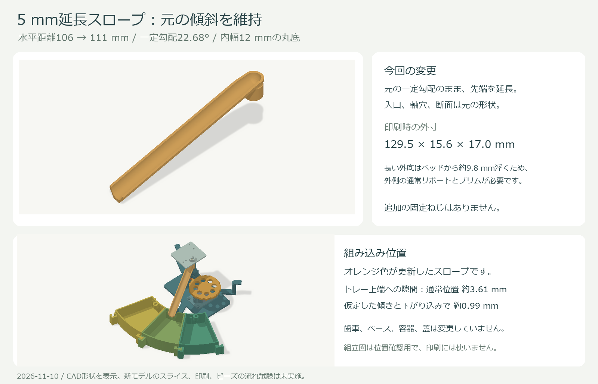
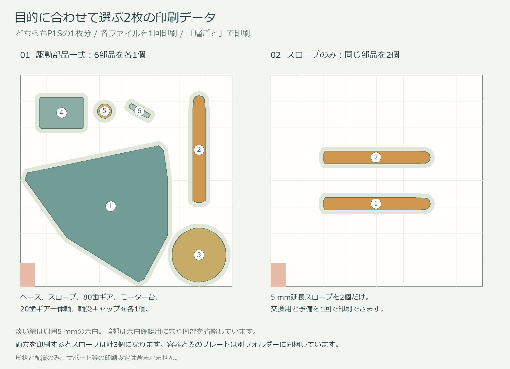

# ビーズ仕分け機 v6 / 元の傾斜を維持した5 mm延長スロープ

更新日: 2026-11-10

**元の22.68°の傾斜を維持し、スロープを水平に5 mm延長しました。** 回転中心から出口まで106→111 mm、斜面に沿う延長では約5.42 mmです。入口、軸の差込部、半円の流路断面を維持しています。

このZIPには、変更対象外の駆動部品、バスケット、中央ケース、全ての蓋も含めたv5相当の一式と、**スロープ2個だけを1回で印刷するプレート**を同梱しました。以前の短いスロープと20 mm延長版の印刷データは含みません。

## まず使う印刷データ

| 目的 | ファイル | 1回でできるもの |
|---|---|---|
| 下部の駆動部品を一式作る | `print/01_motion_complete_plus5_P1S.3mf` | ベース、5 mm延長スロープ、80歯ギア、20歯ギア一体軸、モーター台、軸受キャップを各1個 |
| 交換用スロープと予備を作る | `print/02_two_chutes_plus5_P1S.3mf` | **5 mm延長スロープを2個だけ** |

**上の01と02は、どちらもP1Sの1プレート、1回分です。両方を印刷すると、スロープは合計3個になります。** 従来の駆動部品を使う場合は、02だけを印刷すればスロープを2個用意できます。

両方とも、各部品の投影形状の外側5 mmが造形範囲内に収まります。部品間の最小間隔は一式用で約11.83 mm、スロープ2個用で40.4 mmです。左手前18 × 28 mmの除外領域を避けています。各部品は直接ビルドプレートから造形を開始する配置です。

## 容器と蓋も作る場合

容器と蓋のデータは変更せず、`print/containers/` に収録しています。このフォルダーの02は、上のスロープ2個用02とは別のファイルです。

| ファイル | 1回の印刷内容 |
|---|---|
| `print/containers/02_five_bins.3mf` | 27°バスケット5個 |
| `print/containers/03_five_bins.3mf` | 残りの27°バスケット5個 |
| `print/containers/04_central_case_and_three_lids.3mf` | 中央ケースと27°バスケット用蓋3個 |
| `print/containers/05_central_lid_and_three_lids.3mf` | 中央ケースの蓋と27°バスケット用蓋3個 |
| `print/containers/06_bin90_and_lid90.3mf` | 90°バスケットと専用の蓋 |
| `print/containers/07_four_lids.3mf` | 残りの27°バスケット用蓋4個 |

一式用01と容器フォルダーの6枚を各1回印刷すると、**本番30部品が計7回でそろいます。** スロープ2個用02をさらに追加する場合は計8回、32部品です。既に印刷済みの容器と蓋は再使用できます。

`print/optional/OPTIONAL_fit_checks.3mf` は、外周継手、蓋、本体位置決めの試験片6点です。任意の追加プレートで、上の回数には含めていません。

## Bambu Studioでの設定

3MFは形状と配置のデータです。プリンター、材料、積層、サポート等の設定とG-codeは含みません。使用するP1S、ノズル、フィラメントに合わせて設定します。単色で印刷でき、AMSは必須ではありません。

1. 単位はmm、縮尺100%で開き、保存された位置と上下の向きを維持します。自動配置や自動回転は不要です。
2. **印刷順序は「層ごと / By layer」**にします。特に一式用01は高さ90 mmのベースを含むため、「オブジェクトごと」の順次印刷では使わないでください。
3. **ベースとスロープには通常サポートを有効にします。** Normal形式、ビルドプレート上のみ、水平拡張0 mmを出発点にします。
4. スロープは流路を上に向け、長い外底を水平にした向きです。**長い外底はベッドから約9.8 mm浮くので、外底下面と根元の支持が必要です。** サポートなしでは印刷しないでください。
5. スロープの流路と差込軸穴、ベースのボルト穴や軸受穴へサポートが詰まらないよう、必要に応じてサポートペイントで除外します。差込軸穴の天井は約3.2〜5.2 mmの橋渡しとなるため、プレビューで処理を確認します。
6. スロープは根元の接地面が小さいため、5 mm程度のブリムを出発点にします。一式プレートでは5 mmを超えて広げず、サポートとそのブリムも含めて、確保した周囲5 mmの範囲内に収まることを確認します。
7. スライス後、長い外底の支持、軸穴の橋渡し、歯先や薄い壁が残ること、サポートやブリムが隣の部品へ接触しないことを確認して印刷します。

0.4 mmノズルなら、駆動部品とスロープは積層0.16 mm、Arachneを開始設定にできます。流路表面を整えるため、外側サポートの除去後にバリと糸引きを残さないようにします。

| 部品 | 外周数の目安 | 充填率の出発点 |
|---|---:|---:|
| ベース | 4〜5周 | 30〜40% |
| スロープ | 4周 | 100% |
| 80歯ギア | 5周 | 40%以上 |
| 20歯ギア一体軸 | 5周 | 100% |
| モーター台 | 4周 | 40% |
| 軸受キャップ | 4〜5周 | 100% |
| バスケットと中央ケース | 4周 | 15〜20% |
| 蓋 | 3〜4周 | 20% |

スロープの底中央の縦厚は1.8 mmですが、斜面に直角な最短肉厚は元と同じ約1.33 mmです。薄い部分に外周4周がそのまま入るとは限りません。小ギアの歯先幅は約0.45 mmなので、形が省略されていないことを確認してください。

容器は0.20 mm、蓋は0.16 mmも候補です。容器と蓋は元v5の向きで、原則サポート不要の設計です。蓋の0.7 mmの弾性部などが残ることをプレビューで確認します。

実際のスライス、印刷、今回の5 mm延長モデルでのビーズ通過は未確認です。印刷時間と材料使用量は、設定後にBambu Studioで確認してください。

## 組立と交換

従来の下部機構を使う場合は、スロープだけを交換します。モーターを止め、元スロープを差込軸から外し、新スロープの軸穴の2面を合わせ、元と同じ深さまで差し込みます。新しい固定ねじはありません。

新規に一式を作る場合も組立はv5と同じです。モーター台と28BYJ-48をベースに固定し、20歯ギア一体軸を軸受キャップで保持します。80歯ギアをモーター軸へ固定し、スロープを取り付けます。下部の仕分け用機構であり、フィーダー用DCモーターの取付部品ではありません。

固定部品は従来どおり、M3×8が5本、M3×12が8本、M3ナットが13個です。モーター台の底側4本には頭の高さ2.2 mm以下のM3×8ボタンボルトを使います。上部機構、中間プレート、モーター、制御機器、電源と配線は既存品を使います。組立手順は `ASSEMBLY.md` にまとめています。

## データの内容と確認結果

- `stl/`: 更新スロープ1種類と、変更しない部品17種類。任意試験片6種類を含みます。
- `print/`: 駆動一式用とスロープ2個用の新しい2枚、および元の容器、蓋、任意試験片のプレート。
- `assembly/`: 新スロープを取り付けた稼働状態と、元の収納状態の確認用3MF/GLB。印刷には使いません。
- `source/`: スロープと新しい2枚のプレートを再生成するソース。変更しない部品は同梱のSTLを使用します。
- `verification/`: 寸法、元形状との互換性、出力ファイル、部品数、配置の確認記録。

出力したSTLと3MFを読み戻し、形状が一致すること、閉じた単一立体であること、P1Sの範囲と余白に収まることを確認しました。スロープの外寸は約129.46 × 15.60 × 16.99 mmです。

トレー上端への隙間は公称約3.61 mm、以前の検討と同じ全方位1.2°の傾きと0.3 mmの軸の下がりを仮定して約0.99 mmです。これらは実測のがたではありません。元からある入口の横傾き時の微小接触は残るため、組立後は入口側も含め、手でゆっくり旋回して接触がないことを確認します。詳細は `CLEARANCE-NOTES.md` を参照してください。

変更対象外の部品と収納用プレートは元v5とファイル単位で一致し、稼働状態の組立モデルもスロープ以外の18部品は元と同じ形状です。以前のZIPと印刷データは変更していません。
