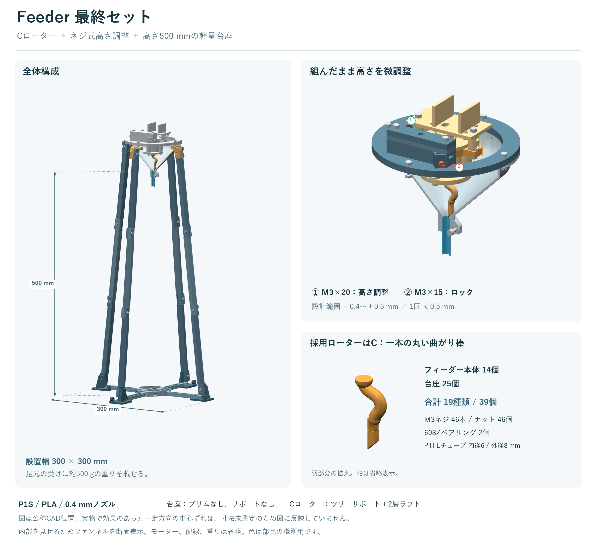

# Feeder最終セット

Cの丸い曲がり棒ローター、ネジ式高さ調整、出口高さ約50cmの軽量台座をまとめたセットです。
採用部品の形状を保ったまま、必要な部品だけを2枚の印刷プレートへ整理しました。
2026年11月8日時点の構成です。

## 印刷するファイル

Bambu Studioで下のスライス済み3MFを開きます。
P1S、0.4mmノズル、単色PLA、Textured PEIプレートを設定済みです。

| 印刷 | 開くファイル | 内容 | 時間の予測 | PLAの予測 |
|---|---|---|---:|---:|
| 1枚目 | [本体の3MF](print/01_feeder_P1S_PLA_sliced.3mf) | ファンネル、Cローター、高さ調整など14個 | 約6時間39分 | 155.2g |
| 2枚目 | [台座の3MF](print/02_stand_P1S_PLA_sliced.3mf) | 脚、足、重り受けなど25個 | 約11時間09分 | 340.1g |
| 合計 | 上の2枚 | 19種類、39個 | **約17時間47分** | **495.4g** |

時間と材料量はBambu Studio 2.8.2.61のスライサー予測です。
実測時間ではなく、準備、冷却、支持材除去、組立の作業時間は含みません。
2枚目は既存V11の最終プロジェクトと同一データです。

[本体のプレート配置](preview/final_feeder_print_plate.png) ／ [台座のプレート配置](preview/stand_print_plate.png)

**Cローターだけ再印刷する場合**は、[C単品の3MF](print/optional_rotor_C_P1S_PLA_sliced.3mf)を使います。
予測は約47分、3.6gです。
Cは1枚目にすでに含まれるため、初回に3枚すべてを印刷する必要はありません。
すでに本体が完成していれば、2枚目の台座だけで追加できます。

## 印刷設定

| 設定 | 本体プレート | 台座プレート |
|---|---|---|
| 主層／初層 | 0.16／0.20mm | 0.20／0.20mm |
| 外周 | 4周 | 4周 |
| 充填 | 40% Gyroid | 40% Gyroid |
| 上下 | 各6層 | 各5層 |
| サポート | Cだけツリー。他13個はOFF | 全部OFF |
| ラフト | Cだけ2層 | なし |
| ブリム | Cはなし。他13個は外側2mm | なし |

台座はブリムもサポートも使わない設計です。
本体はこれまでの印刷条件を引き継ぎ、Cの支持材と他部品の2mmブリムを残しています。
部品別設定を保存しているため、プレート全体のサポート設定だけで判断せず、Cのオブジェクト設定も確認できます。

ノズル220℃、プレート55℃を設定しています。
使用するPLAやプレートの指定温度が異なる場合は、その条件に合わせて再スライスします。
全体を層ごとに印刷する設定を使い、オブジェクトごとの順次印刷には変更しません。
個別STLもベッドへ置く向きを設定済みです。

`print` の末尾が `_sliced` ではない同名3MFは、再スライス用の設定済みプロジェクトです。
`plates` は形状と配置だけの3MFなので、そのまま同じ支持材設定が得られるわけではありません。

## 用意する部材

| 部材 | 最終セット全体の必要数 |
|---|---:|
| M3×6 | 1本 |
| M3×8 | 2本 |
| M3×12 | 5本 |
| M3×15 | 33本 |
| M3×20 | 5本 |
| M3ナット | 46個 |
| 698Zベアリング（8×19×6mm） | 2個 |
| PTFEチューブ | 内径6mm、外径8mm |
| 現在のモーター、適合する電源と配線 | 1式 |
| 幅2〜2.5mmの結束バンド | モーター用2本 |
| 低位置の重り | 約500g |

ねじは計46本です。
六角穴付き円筒頭を使い、ねじ長さは頭を除いて数えます。
リム4か所は本体と台座をM3×20で共締めします。
台座なし時のM3×12を重ねて数えていません。

## 組み立てと調整

[組立説明書](docs/assembly_ja.md)に、全部品一覧、ねじの使用箇所、初回組立、台座だけの追加、高さ調整をまとめました。
足元のつなぎ材とナットを先に組み、それから脚を付ける順番です。
高さは上のM3×20で動かし、外側のM3×15で固定します。
吐出口まで約500mm、足幅約300×300mmで、足元へ約500gの重りを載せます。

現物で効果のあった一定方向の中心ずれは、寸法未測定のためCADに数値として反映していません。
現在うまく動いている本体は、その設定のまま使えます。
V11台座の実印刷と強度、長期使用は未検証です。

## ファイルの使い分け

| フォルダー／ファイル | 用途 |
|---|---|
| print | P1S用の設定済み3MFとスライス済み3MF |
| parts | 採用した19種類の個別STL、3MF、編集用STEP |
| cad | 本体と台座の組立STEP。金物を含む確認用 |
| preview | 全体図、印刷配置、高さ調整、Cの拡大図 |
| docs/assembly_ja.md | 組立説明書 |
| manifest.json | 部品数、金物、元データとの対応 |
| print_summary.json | 2プレートとC単品の時間と材料量 |
| verification、slicer | 検証結果とスライス条件 |
| source | 今回の整理、配置、図の再生成スクリプト |

組立STEPには金物とPTFEの参照形状が含まれるので、印刷対象にはしません。
個別STEPはそのままCADで編集できます。
旧2枚羽、固定ブリッジ、A/B/D比較案、V10台座は配布用の印刷部品から除いています。
