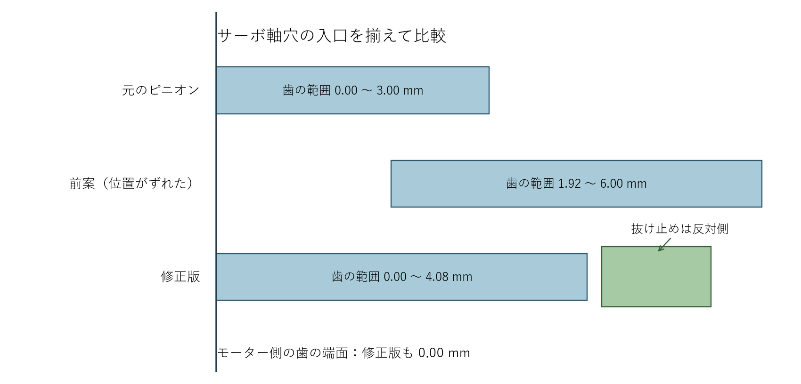
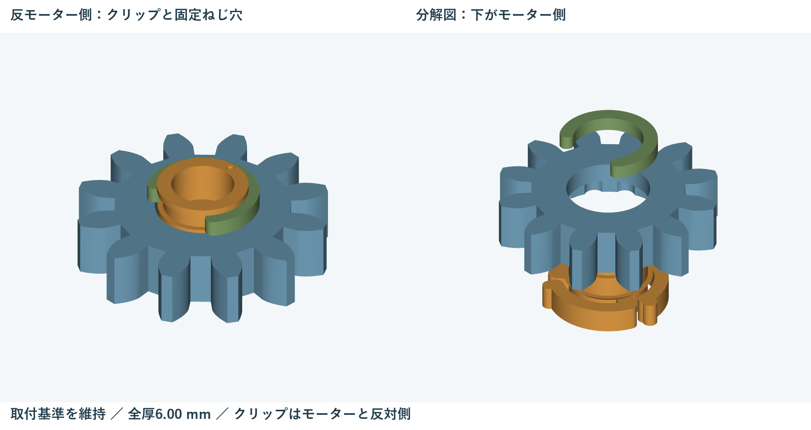
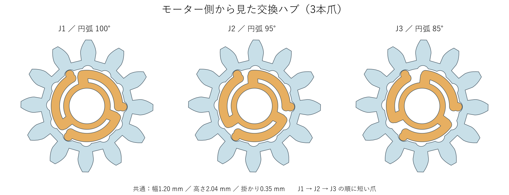

# 元のモーター取付位置を維持するクラッチ

元の `pinion.3mf` のモーター側の歯の端面、サーボ軸穴の入口と深さ、固定ねじの座位置を基準にした設計です。
**元の歯があった範囲を残し、追加の厚みとクリップをモーターと反対側へ配置します。**
全厚は樹脂部品で6.00 mm以内です。

前の6 mm版は、軸穴への差し込み深さを揃えると歯のモーター側端面が1.92 mm離れる設計でした。
今回の版はその変更を取り消しています。
前案の部品との混用を前提にせず、この版の外周、ハブ、クリップをセットで使用してください。

## 取付基準

図と組立データでは、モーター側の歯の端面とサーボ軸穴の入口を `z=0` に揃え、モーターから離れる方向を正としています。
以下は外周がハブの肩に当たる基準位置の寸法です。

| 箇所 | 元のピニオン | 修正版 |
| --- | ---: | ---: |
| モーター側の歯の端面 | 0.00 mm | 0.00 mm |
| 歯の存在する範囲 | 0〜約3.00 mm | 0〜4.08 mm |
| サーボ軸穴の入口 | 0.00 mm | 0.00 mm |
| サーボ軸穴の径 | 5.00 mm | 5.00 mm |
| サーボ軸穴の深さ | 約2.81 mm | 約2.81 mm |
| 固定ねじの座位置 | 約3.00 mm | 約3.00 mm |
| 全厚 | 約3.00 mm | 6.00 mm |

元の歯幅の中心は約1.50 mm、修正版の歯幅の中心は2.04 mmです。
中心の違いは、反対側へ歯幅を追加した分によるものです。
元の約0〜3 mmの歯の形状と配置を維持しているため、ラックやモーターの取付位置を移動することを設計の前提にしていません。

回転を妨げないため、外周には軸方向の遊びがあります。
クリップの溝内での移動も含め、外周は基準位置から反モーター側へ最大0.24 mm動けます。
これは公称取付位置の移動とは区別して設けた回転用の隙間です。
実機の印刷誤差を含む動きは未確認です。

## 部品の配置

モーター側に3本の弾性爪、反対側にクリップ溝と抜け止めのつばを置きます。
サーボ軸はモーター側の直径5 mmの穴へ入り、固定ねじは反対側の座ぐりから入れます。
クリップの中央を通して固定ねじへアクセスできます。

ねじ頭とドライバーを通すため、反モーター側にも直径4.60 mmの座ぐりが必要です。
この穴を考慮し、溝底には0.60 mmの肉厚を残しています。
溝底の直径は5.80 mm、軸の通常部分は6.60 mmで、溝の深さは半径方向に0.40 mmです。
抜け止めのつばの直径は6.70 mmで、溝底との段差は0.45 mmです。

専用クリップの内径は5.90 mm、厚さは1.20 mmです。
つばとの半径方向の掛かりは公称0.40 mmあります。
クリップC1は軸を245度、C2は255度囲み、C2の方が開口が狭い形です。
まずC1を使い、外れやすい場合にC2を試します。
旧クリップやK1、K2は内径が異なるため、この版には混用しないでください。

## ハブの比較

保持力を上げるため、3本爪、幅1.20 mm、高さ2.04 mm、掛かり0.35 mmを共通としています。
これらは強化ハブF〜Hを基にした寸法で、円弧の長さを比較します。
J1→J2→J3の順に短くなり、滑りにくくなることを狙っています。
保持力の値と実際の順位は未測定です。

| ハブ | 円弧角度 | 円弧長さ | 反モーター側の凹点 |
| --- | ---: | ---: | ---: |
| J1 | 100度 | 約7.77 mm | 1個 |
| J2 | 95度 | 約7.38 mm | 2個 |
| J3 | 85度 | 約6.60 mm | 3個 |

## 印刷するファイル

- `print/01_all_trials_P1S_PLA.3mf`：P1S、0.4 mmノズル、PLAの参考設定付き。
- `plates/00_all_trials_geometry.3mf`：設定なしの同じ部品セット。
- `parts/` と `stl/`：個別部品。
- `assembly/assembled_J1_VIEW_ONLY.3mf`：組立確認用。そのまま印刷するデータではありません。

セットは外周1個、ハブJ1〜J3各1個、クリップC1とC2各1個の合計6個です。
参考設定の見積もりは約32分、PLA約1.3 gです。
外周は平らな反モーター側の面、ハブは爪とサーボ軸穴のある面をベッド側に置きます。
クリップは平置きです。
すべて印刷姿勢に配置済みです。

参考設定は積層0.12 mm、初層0.20 mm、Arachne、壁4周、同心円100%です。
サポート、ラフト、ブリムは付けません。
印刷経路はこの設定で確認済みです。

## 組み立てと確認

1. ハブJ1を用意します。直径5 mmの穴が開いた爪側がモーター側、クリップ溝と凹点のある側が反モーター側です。
2. ハブの反モーター側の先端から外周をかぶせます。外周の大きな開口を爪側へ向け、爪先を内周のくぼみに合わせて、肩に当たる位置まで入れます。
3. 反モーター側の溝にクリップC1を横から差し込み、溝の奥まで入ったことを確認します。
4. 中心ハブを持って外周を左右に回し、爪がくぼみを乗り越えること、外周が抜けないことを確認します。
5. 元のピニオンと同じ向き、同じ差し込み深さでサーボへ取り付け、反対側から固定ねじを締めます。
6. 元の位置のラックと噛み合うことを確認し、正常なビーズの押し出しと詰まり時の逃げを短い動作で試します。
7. J1でも保持力が足りない場合にJ2、J3へ交換します。爪が滑らず機構を無理に押すものは使いません。

固定ねじの座を元の位置へ戻したため、ねじの長さも元のピニオンと同じ条件です。
前案に合わせて長いねじへ変更していた場合は、そのまま使わず、元の長さとねじ込み深さを確認してください。
ねじ頭が直径4.60 mmの座ぐりに入ることも確認します。

元データのねじ座は約0.192 mmと薄く、この版では座位置と差し込み深さを優先してその厚さも維持しています。
印刷後にねじ座が形成されていることを確認し、締め付けで潰さないようにしてください。
元の取付穴は丸穴で、サーボのスプライン形状は含まれていません。

クリップの装着で白化や亀裂が出たもの、開いたまま戻らないものは交換します。
詰まったまま長時間滑らせ続ける用途は対象外です。
手動復帰では、自動動作を止めてサーボを戻り角度にした後、ラックを元の目印へ戻します。

## 検証の基準

`source/verify.py` で、書き出した3MFを読み直して元の入力と比較しました。
比較対象はモーター側の歯の端面、軸穴の入口と深さ、ねじ座位置、元の歯幅内の外形です。
クリップと外周が軸方向に移動した端の位置でも全厚6.00 mm以内に収まることを、24通りの配置で確認済みです。
スライス後の爪と隙間、ねじ座、クリップの印刷経路も確認しました。
結果は `verification/` に保存しています。

実機の取付、印刷精度、滑りトルク、PLAの疲労寿命、クリップの保持力は未確認です。
取付基準を保持する設計であることと、機能が実機で確認済みであることは区別しています。

## 再生成

`source/build.py`、`source/slice.py`、`source/verify.py`、`source/package.py` の順に実行します。
元の入力は `reference/pinion_original.3mf` に保存しています。
依存関係は `source/requirements.txt` を参照してください。
Bambu Studioの実行ファイルとWindowsフォントの場所は環境に応じて変更してください。
