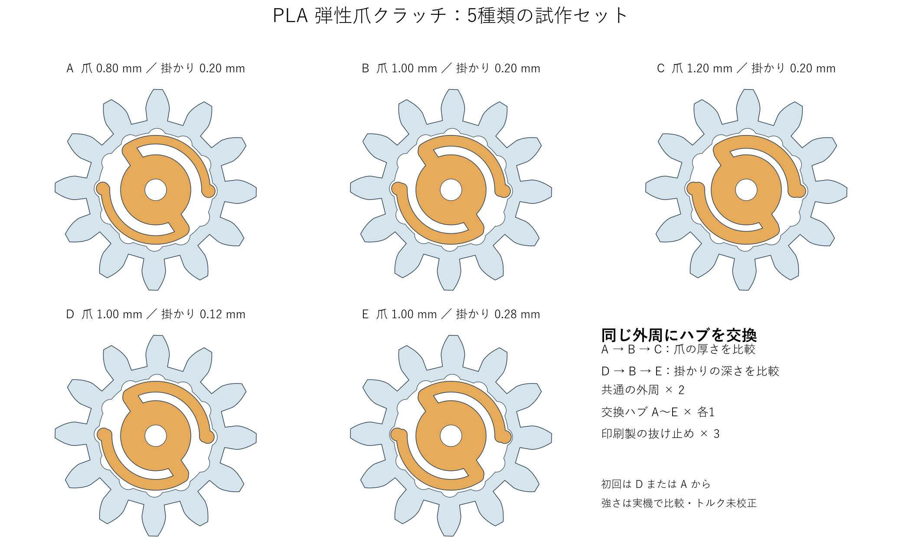
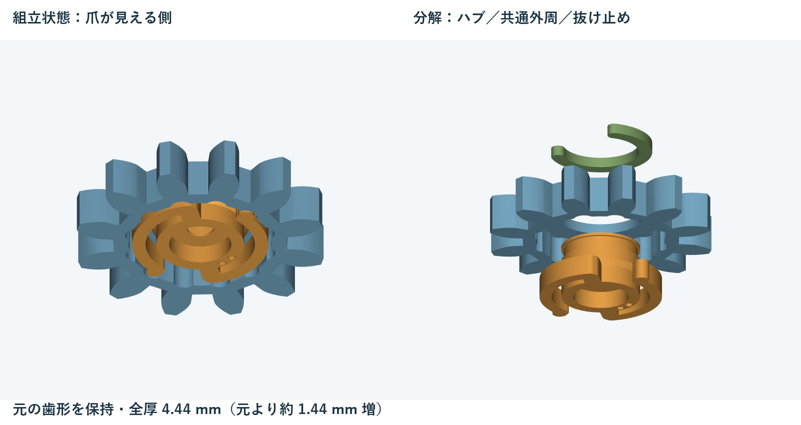

# PLA弾性爪クラッチの試作セット

ビーズの詰まり時やラックの手動調整時に、ピニオン外周とサーボ軸の間で滑らせるための試作部品です。
共通の外周に、厚さと掛かりの違うハブを交換して比較します。
滑る力と寿命は実機で確認する必要があり、校正済みのトルクリミッターではありません。

## 印刷するファイル

P1Sの0.4 mmノズルでPLAを使う場合は、`print/01_all_trials_P1S_PLA.3mf` をBambu Studioで開きます。
既存プロジェクトのP1S設定を基にした参考プロファイルです。
プリンターとプレート、フィラメントが実機と合っていることを確認してください。
スライス済みの参照データは `print/02_all_trials_P1S_PLA_sliced.3mf` です。
プリンターには送信していません。

ほかのプリンターでは、設定を含まない `plates/00_all_trials_geometry.3mf` を開いて機種に合った設定を選びます。
個別部品は `parts/` の3MFと `stl/` のSTLにあります。
すべてmm単位で、印刷姿勢に配置済みです。
`assembly/assembled_B_VIEW_ONLY.3mf` は組立確認専用で、そのまま印刷するファイルではありません。

1プレートに共通外周2個、ハブA〜E各1個、抜け止めクリップ3個を配置しています。
1組に使うのは外周1個、ハブ1個、クリップ1個です。
クラッチのばねや抜け止めに追加の金属部品は使いません。
サーボへの固定は既存の固定方法と固定ねじを使う想定です。

## ハブの違い

**爪の厚さ**は、平置きした爪の半径方向の幅です。
**掛かり**は、爪先が内周の山を乗り越える際に、内側へ逃げる必要がある半径方向の量です。
軸方向の爪の高さは全種類で1.68 mm、円弧部分の角度は125度です。
厚さ変更時は外周側の隙間を保つため、円弧の中心半径も少し変わります。

| ハブ | 爪の厚さ | 掛かり | 比較すること | ねじ側の凹点 |
| --- | ---: | ---: | --- | ---: |
| A | 0.80 mm | 0.20 mm | 薄い爪 | 1個 |
| B | 1.00 mm | 0.20 mm | 基準 | 2個 |
| C | 1.20 mm | 0.20 mm | 厚い爪 | 3個 |
| D | 1.00 mm | 0.12 mm | 浅い掛かり | 4個 |
| E | 1.00 mm | 0.28 mm | 深い掛かり | 5個 |

A→B→Cで厚さを、D→B→Eで掛かりを比較します。
厚い爪や深い掛かりは滑りにくくなる方向の変更ですが、5種類全体の強さの順位やトルク値は未測定です。
凹点は小さいため、プレートから取り外す際もA〜Eを分けて保管してください。

## 印刷設定

| 項目 | 参考設定 |
| --- | --- |
| 材料 | PLA、5種類とも同じ材料 |
| ノズル | 0.4 mm |
| 積層ピッチ | 0.12 mm、初層0.20 mm |
| 壁生成 | Arachne |
| 壁数 | 4周（薄い爪は幅に応じて生成） |
| インフィル | 100%、同心円 |
| 外壁速度 | 25 mm/s、小周長はその50% |
| 内壁速度 | 35 mm/s |
| サポート、ラフト、ブリム | なし |
| 初層の広がり補正 | 0.15 mm |

ハブは爪と凹点のある面をベッド側にします。
外周は平らな背面をベッド側にし、爪が入るくぼんだ側を上にします。
クリップは平置きです。
サポートを爪の隙間に入れないでください。
比較時は材料、向き、温度、速度を揃えます。
爪先を削ると掛かりが変わるため、糸引きやバリを除く際も形を変えないようにします。

参考スライスの見積もりは全10部品で約38分、PLA約1.6 gです。
準備動作を含むスライサー上の値で、実測ではありません。

## 組み立て

1. ハブの円筒部分を上にし、外周の大きな開口を爪側に向けてかぶせます。
2. 爪先が内周の丸いくぼみに入るように外周を少し回します。
3. 外周背面から突き出たハブの溝へ、クリップを横から差し込みます。軸方向に押し込む部品ではありません。
4. ハブを持って外周を左右に回し、爪先がくぼみを乗り越えることと、外周が抜けないことを確認します。
5. サーボの軸を中心の取付穴へ入れ、既存の方法でハブを固定します。

外周の中心穴とハブには直径差0.40 mmを設けています。
軸方向にも片側約0.24 mmの逃げを設け、外周を締め付けない構造です。
爪が動く前に外周が固着する場合は、中心穴、肩、クリップ周辺のバリを確認します。
組み立てで爪を強く曲げる必要はありません。

## 元のピニオンとの寸法差

元の12枚の歯の外形メッシュと、歯幅約3.00 mmを保持しています。
外径は約18.6 mmです。
取付穴は元ファイルに合わせて直径5.00 mm、深さ約2.81 mmとし、中心のねじ通し穴は直径2.00 mmです。
元ファイルの取付穴は丸穴で、サーボのスプライン形状は含まれていません。
実機の嵌合は未確認です。

**組立後の樹脂部分の全厚は4.44 mmで、元より約1.44 mm増えます。**
同じサーボ軸の突き当て位置に取り付けると、歯の位置が軸方向に約1.44 mm移ります。
ラックと歯幅が合うよう、サーボまたはラックの取付位置を調整してください。
元の部品と完全に同じ取付空間へ収まることは確認していません。

ねじ頭用に直径4.60 mm、深さ約1.44 mmの座ぐりを設け、ねじ座から軸穴入口までの距離を元形状と揃えています。
既存ねじの再利用を意図していますが、ねじ頭が座ぐりに入ることを確認してください。
ねじ座の薄い部分は元ファイルと同じ約0.192 mmです。
この部分が印刷されていることを確認し、締め付けで潰さないようにしてください。

## 比較手順

1. 最初はDまたはAを使い、サーボに付ける前に手でカチカチ回せることを確認します。
2. 正常な向きのビーズを押します。通常の押し出しでも滑るなら、同じ比較系列のB、次にCまたはEを試します。
3. 短い動作で詰まりを再現し、外周が止まってもハブ側が進めることを確認します。詰まりを無理に押し切る設定は採用しません。
4. 往復の両方向と、ラックの手動復帰を試します。丸い爪先とくぼみでも、円弧爪の形状によって方向差が出る可能性があります。
5. サーボを戻り角度にした後、ラックを元の目印へ戻します。自動動作は止めておきます。
6. 同じ条件で数十回比較し、滑り方の変化や爪の白化、亀裂を確認します。詰まったまま連続して滑らせる使い方は避けます。

内周には12個のくぼみがあるため、手動時は約30度ごとにカチッと止まります。
通常位置でも爪先とくぼみの間に隙間があるため、回転方向の遊びがあります。
摩擦式のように任意の角度で滑らかに保持する機構ではありません。

| 記録 | 正常時に押せる | 詰まり時に逃げる | 手動で戻せる | 繰り返し後の変化 |
| --- | --- | --- | --- | --- |
| A | | | | |
| B | | | | |
| C | | | | |
| D | | | | |
| E | | | | |

## データ上の確認と未確認事項

書き出した3MFとSTLを読み直し、各部品が閉じた単一の立体であることを確認しています。
元の歯形の保持、基準位置での部品間の干渉、爪先が山を越えるための幾何学的な逃げ量も確認しています。
P1S用の参考データはBambu Studio 2.8.2.61でスライスしています。
確認結果は `verification/` に保存しています。

実際の印刷、装置への取付、PLAの弾性限界、摩耗寿命、滑りトルクは未確認です。
爪の有限要素解析や動的な接触解析は行っていません。
このセットで比較した結果から、次の試作の厚さや掛かりを決めてください。

## 再生成

`source/build.py` で形状と図を、`source/slice.py` でP1S用データを生成します。
`source/verify_exports.py` は書き出したファイルと印刷経路を確認します。
元の入力は `reference/pinion_original.3mf` に保存しています。
Pythonの依存関係は `source/requirements.txt` を参照してください。
スライス用スクリプトのBambu Studio配置先と、画像生成用のWindowsフォントは環境に応じて変更してください。
